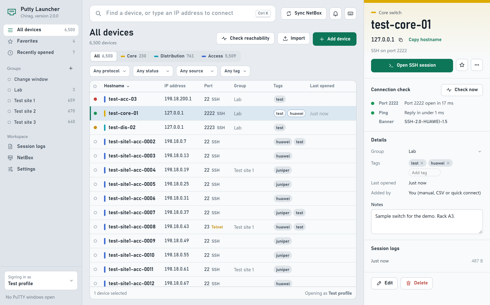
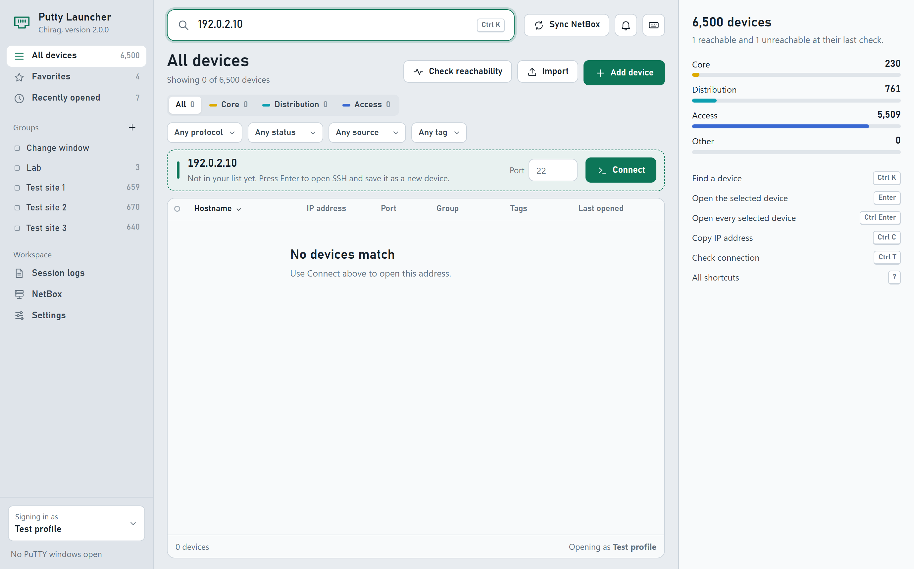
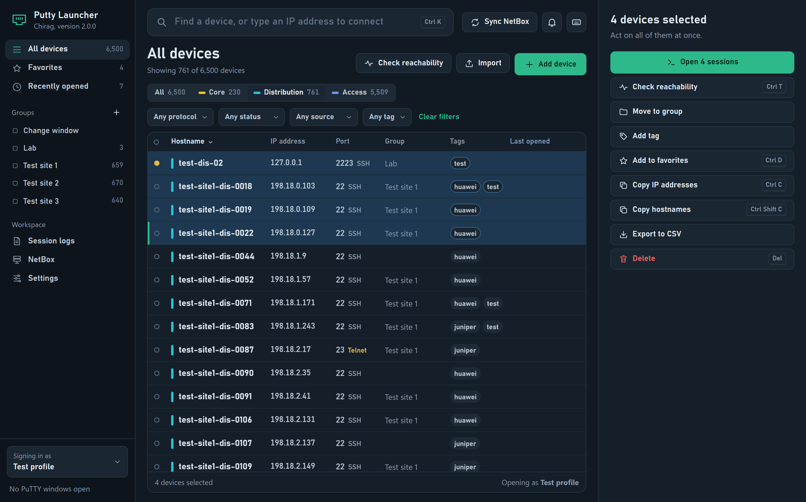
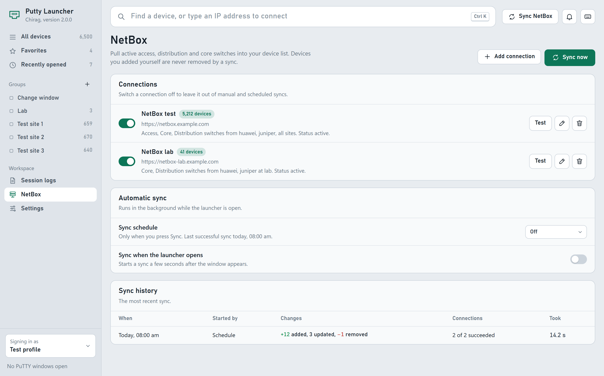
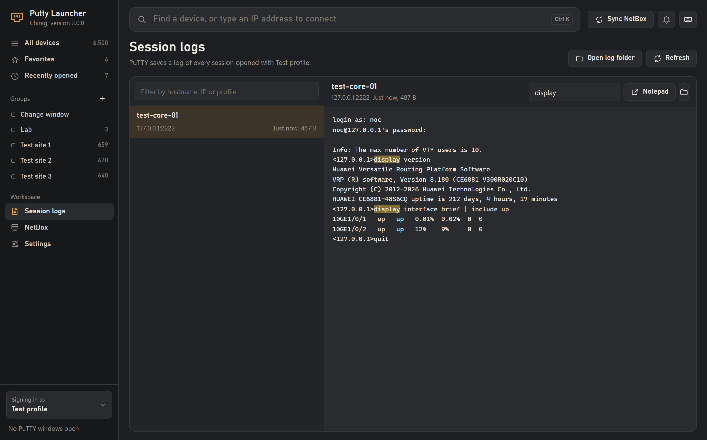
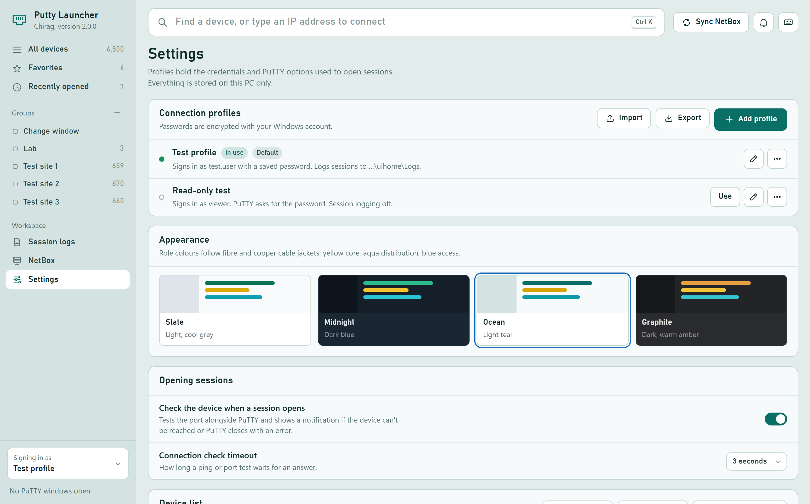

# Chirag Putty Launcher

A Windows desktop app for finding network devices and opening PuTTY sessions to them. Version 2 is a full redesign: a native window with a modern interface, built for inventories of thousands of switches.

**[Download the latest version](https://github.com/chiragbhatn/Chirag-Putty-Launcher/releases/latest)**



- [Screenshots](#screenshots)
- [Features](#features)
- [Keyboard shortcuts](#keyboard-shortcuts)
- [Install](#install)
- [Your data](#your-data)
- [Develop](#develop)

## Screenshots

All screenshots use sample test devices.

| | |
| --- | --- |
|  |  |
| **Quick connect:** type any IP address and press Enter. | **Bulk actions** in the Midnight theme. |
|  |  |
| **NetBox** connections, schedule and sync history. | **Session logs** with find-in-log, in the Graphite theme. |
|  | |
| **Profiles and themes**, here in Ocean. | |

## Features

### Find and open devices
- One search box finds devices by hostname, IP address, group, tag or note. Several words narrow the search. Press Enter to open the top match.
- Type an IP address that isn't in your list, optionally as `ip:port`, and press Enter to connect straight away. It's saved as a new device. If the IP is already in your list, that device opens instead of a duplicate being added.
- Port 23 opens Telnet, where you sign in by hand. Any other port opens SSH and signs in automatically with the active profile's TACACS username and password.
- A device can open a saved PuTTY session instead. The device form lists the sessions saved in PuTTY.
- Open several selected devices at once. The app asks first before opening more than eight.
- Recently opened keeps your last 20 devices, with when you opened them and which profile you used.
- Every device shows when it was last opened.

### Device list
- Stays fast with 6,500+ devices.
- Devices are colour-coded by role, after fibre and copper cable jackets: yellow for core, aqua for distribution, blue for access. The role comes from the `-core`, `-dis` or `-acc` hostname suffix, or from the device's role in NetBox.
- Filter by role, protocol (SSH or Telnet), reachability, source (added by you or synced from NetBox) and tag. One click clears all filters.
- Sort by status, hostname, IP address (in numeric order), port, group, tags or last opened.
- Select several devices with Ctrl-click, Shift-click, Shift+arrow keys or Ctrl+A.
- Right-click any device, or a selection, for a menu of actions.
- With nothing selected, a summary shows how many core, distribution and access devices you have, and how many were reachable at their last check.
- Rows that share an IP address and port are all kept, and the device panel tells you when an address is shared.

### Device panel
Selecting a device shows its details on the right:
- Hostname, IP address and protocol, with one-click copy for the IP address or hostname.
- An Open session button for SSH, Telnet or the saved session.
- Connection check: the port test with its response time, the SSH banner the device sends, and ping.
- The last connection failure, if there was one.
- Group picker, tag editor and notes. Notes save when you click away.
- Recent session logs for that device.
- Edit and Delete.

With several devices selected, the panel offers: open all, check reachability, move to a group, add a tag, add to or remove from favorites, copy IP addresses, copy hostnames, export to CSV and delete.

### Organise devices
- **Groups** in the sidebar, with device counts. Create, rename and delete them. Drag devices onto a group to move them there. Deleting a group keeps its devices. Right-click a group to check every device in it.
- **Favorites**: click the star on a row, press Ctrl+D, or drag devices onto Favorites.
- **Tags**: add or remove tags on one device or many at once.
- **Notes** on every device.
- Add, edit and delete devices. The form checks the IP address and port, and warns when another device already uses them.

### Connection checks and alerts
- **Check now** tests one device's port, reads its SSH banner and pings it.
- **Check reachability** tests a whole list, group or selection. It runs in the background, checks many devices in parallel, shows progress and can be stopped.
- Each device shows a status light: reachable, answers ping but the port is closed, unreachable, or not checked yet.
- **When you open a session**, the launcher tests the port alongside PuTTY without slowing it down. You get a notification if the device can't be reached or PuTTY closes with an error, and the device is marked.
- **Notifications** (the bell) keep recent connection failures, sync results and check results.
- The check timeout can be set from 1 to 10 seconds.

### Session logs
- Turn on logging in a profile, and PuTTY saves a dated log of every session to that profile's log folder.
- The Session logs page lists every log, filtered by hostname, IP address or profile.
- Read a log in the app, with find-in-log highlighting. Long logs show their last 400 KB.
- Open a log in Notepad, show it in its folder, or open the whole log folder.

### NetBox
- Add several NetBox connections. API tokens are stored encrypted. Self-signed and internal certificates are accepted.
- Each connection has its own filters: device roles (core, distribution, access), manufacturers (Huawei and Juniper by default), sites, device status, and models to skip.
- Turn a connection off to leave it out of syncs without deleting it.
- **Test** a connection to see its NetBox version, how many devices match its filters, and how long it took to answer.
- Sync on demand (F5), on a schedule (every 15 or 30 minutes, every 1, 4 or 12 hours, or once a day), or a few seconds after the app opens.
- **Sync history** keeps the last 40 syncs: when each ran, what started it, devices added, updated and removed, which connections succeeded, the reason any failed, and how long it took.
- Syncs are safe:
  - Devices you added yourself are never removed.
  - A connection that fails is left exactly as it was.
  - Existing devices keep their ports. New NetBox devices use port 22.
- Errors are in plain language, such as "Couldn't find netbox.example.net. Check the URL and that you're on the right network or VPN." A NetBox server that stops answering times out after 30 seconds.
- The Sync button turns red when the last sync had problems, and a scheduled sync that keeps failing waits a full interval before trying again.

### Connection profiles
- Keep several profiles, each with a TACACS username and password, PuTTY location, session logging on or off, and a log folder.
- Switch the active profile from the sidebar or with Ctrl+Shift+P, and set a default.
- Passwords are encrypted with your Windows account and are never shown in the interface. If a profile has no password saved, PuTTY asks you to sign in.
- **Import and export profiles** to move them between PCs. Passwords are left out of exports unless you choose to include them.

### Import, export and backup
- **CSV import** shows a preview first: valid rows, new devices, devices already in your list, and any problem rows by row number. Rows with problems block the import until they're fixed. Columns can be in any order, and `hostname` or `sysname` both work.
- **CSV export** of all devices or just the selected ones, including groups, tags, notes and saved sessions.
- **Back up and restore** all settings in one file: profiles, NetBox connections, groups and preferences.
- Your 1.x files are backed up automatically the first time version 2 starts. If the settings file is ever damaged, a copy is kept instead of being overwritten.

### PuTTY windows
- The sidebar shows how many PuTTY windows are open.
- **Close all** closes every PuTTY window at once (Ctrl+Shift+Q). It asks first.

### Look and feel
- Four themes: Slate (light grey), Midnight (dark blue), Ocean (light teal) and Graphite (dark amber). Your choice is remembered.
- Works offline. No internet connection is needed except for NetBox and the update check.
- Adapts to smaller windows, down to 1000 pixels wide.
- Check GitHub for a newer version from Settings.

## Keyboard shortcuts

Press `?` in the app to see these at any time.

| Action | Keys |
| --- | --- |
| Find a device or type an IP address | Ctrl K (or Ctrl F) |
| Open the selected device | Enter (or double-click) |
| Open every selected device | Ctrl Enter |
| Move through the list | ↑ ↓, Page Up, Page Down, Home, End |
| Extend the selection | Shift ↑ ↓ |
| Select all shown | Ctrl A |
| Copy IP address | Ctrl C |
| Copy hostname | Ctrl Shift C |
| Check connection | Ctrl T |
| Add or remove favorite | Ctrl D |
| Edit device | F2 (or Ctrl E) |
| Delete device | Del |
| Add a device | Ctrl N |
| Import a CSV | Ctrl I |
| Sync NetBox | F5 |
| Switch profile | Ctrl Shift P |
| All devices, Favorites, Recently opened | Ctrl 1, Ctrl 2, Ctrl 3 |
| Session logs, NetBox, Settings | Ctrl 4, Ctrl 5, Ctrl 6 |
| Device menu | Shift F10 |
| Close all PuTTY windows | Ctrl Shift Q |
| Clear the search, close a dialog | Esc |
| Show all shortcuts | ? |

## Install

1. Download `ChiragPuttyLauncher_Setup_2.0.0.exe` from the [releases page](https://github.com/chiragbhatn/Chirag-Putty-Launcher/releases/latest).
2. Run it and approve the Windows prompt. It upgrades an existing 1.x install in place, and your shortcuts keep working.

You need:
- Windows 10 or 11.
- The Microsoft Edge WebView2 Runtime. Windows 11 already includes it, and the installer offers the download if it's missing.
- PuTTY.

## Your data

Everything is stored on your PC in `%APPDATA%\ChiragPuttyLauncher`:

- `config.json`: profiles, NetBox connections, groups, sync history and preferences. Passwords and API tokens are encrypted with Windows DPAPI, so they only open on your Windows account.
- `devices.csv`: the device list.
- `Logs\`: session logs, unless a profile uses another folder.

The first time version 2 starts, it copies your 1.x files to `config.before-v2.json` and `devices.before-v2.csv` in the same folder.

## Develop

```powershell
python -m pip install -r requirements-build.txt
python device_launcher_app.py          # run the app
python test_launcher.py                # offline tests (no PuTTY, no network devices)
```

Code layout:

- `launcher_core.py`: storage, NetBox sync, diagnostics, PuTTY commands and session logs. No UI code.
- `device_launcher_app.py`: the native window (pywebview) and `LauncherApi`, the bridge the UI calls.
- `launcher_ui/`: the interface (HTML, CSS and JavaScript, no external libraries, works offline).
- `dev_server.py`: serves the UI in a normal browser for development. Set `CHIRAG_LAUNCHER_HOME` to a test folder so your real data is untouched.

Build the EXE and installer:

```powershell
pyinstaller --noconfirm ChiragPuttyLauncher_NetBox.spec
& "$env:LOCALAPPDATA\Programs\Inno Setup 6\ISCC.exe" ChiragPuttyLauncher_NetBox_Setup.iss
```

The EXE is written to `dist\` and the installer to `installer_output\`.
